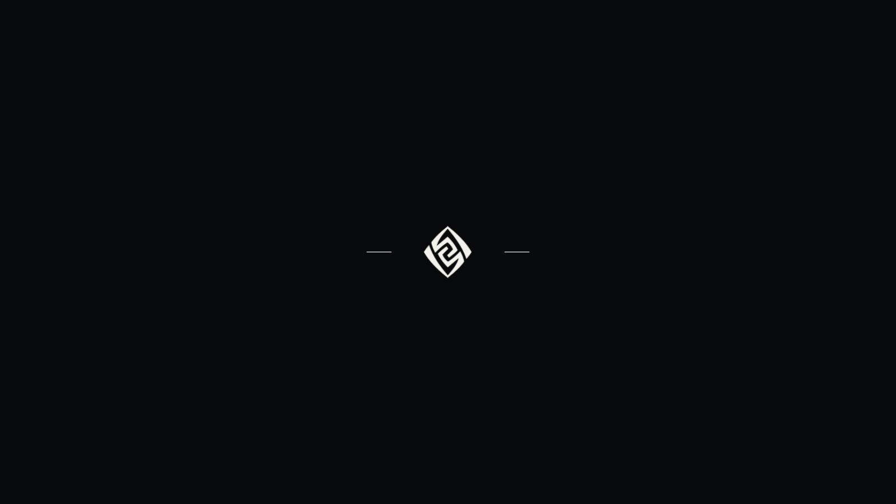
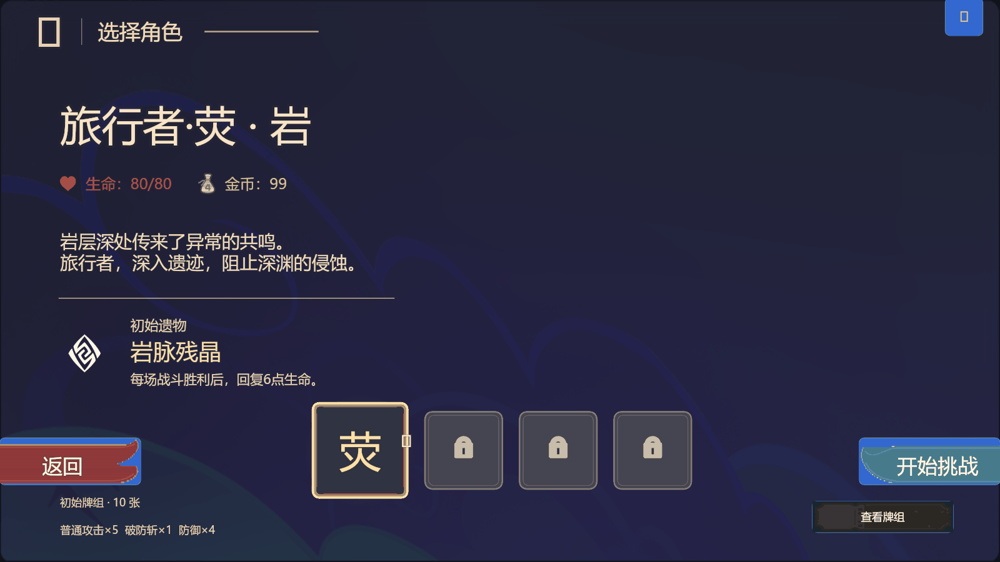

# TASK-105 璃月黑白开局转场

复用原有 prologuePanel / abyss_prologue、Host OnUpdate、covering/opaque、页面可见性和取消接口。确认角色后先锁定确认操作，0.24 秒淡入黑色遮罩，在全黑时调用原 beginRun；白色原生岩印停留 0.38 秒，随后 0.24 秒揭示现有 Neow 开局。每次确认只创建一个 Run；规则、随机种子与开局恩赐仍由原入口处理。规则专用 Host 保持即时模式，生产 abyss_ui 明确启用短过场。

只保留璃月方向的岩印与两条短线，无文案、无现实时间切换。复用原生 Geo 图库图片 102005，没有提取或导入参考存档资产。参考存档只读检查得到 83 个节点；本轮没有接入这些节点。

原过场面板 50 个控件，现为 7 个（面板、遮罩、徽记容器、徽记图片、两条线、全屏输入拦截区），减少 43 个。控件只创建一次；逐帧更新 4 个图片颜色和 1 个容器缩放，不重建控件、不引入新模块或生命周期系统。颜色、尺寸和时间统一来自 ui_theme；merchant 共用的句子/字符拆分函数保留。

过场全程隐藏菜单入口，公共命令和陈旧点击回调拒绝输入；目标页在淡出时可见但仍无交互。完成、取消、禁用、失败提交均清理遮罩；宽屏/竖屏尺寸沿用 viewport 缩放计算。独立评审发现并修复了菜单提升到遮罩上方的问题，同时修复输入测试错误 action key 的盲区。

本轮验证：

- 真实 Lua Host 转场 10 项，包含确认前后时序、重复点击、真实 Neow action/回调隔离、取消、禁用、大帧间隔、宽屏/竖屏和败局重开。
- 定向菜单/原生开局/计时回归最终 12 项通过；其中修改后重跑 game-ui/title-menu 两文件 9 项，其余 3 项前轮通过。
- check:engineering 通过：346 模块架构、Luacheck 无新增诊断、4 项关键变异被断言杀死、6 项原生合同通过。
- check:platform-load 日常预算通过；其历史全局增长不是本次转场增量，不代表官方容量或设备性能。
- 官方导入、当前 ready、手机/PC 实测与视觉 GO 尚未取得，由用户手动导入本轮副本验证；不将离线验证写作实机通过。

候选采用仓库已有 official-assets + native-page-lifecycle 测试配置，非发布候选。源基线 9f2f44e4c79789fbcb64a515938765dbc240f830，加本 PR 运行时改动；构建收据标记 sourceDirty=true，源码在打包后未再变更。存档 SHA256：62f239957fe0b0d86ee99edf81d93daa5d206ff64e7aff6b9f97a124cda3145a。静态构建与独立读回通过，361 个 Lua 模块；模拟器转换逆向核对 0 差异。

用户交付路径：`F:\New folder\交付\璃月黑白转场-20261114\Slay-the-Abyss-璃月转场.gil`。请作为新存档导入，走“启程 → 确认岩系旅行者 → 过场 → 七天神像”，检查过场不可点击下层、结束可选恩赐、无残留遮罩。本轮没有自动发布。

实际候选运行截图（BeyondSimulator Host 软件 PNG，非官方客户端）：

[原始截图收据与本轮运行日志](../evidence/liyue-transition/capture.json)绑定上述候选。手动时钟采样为确认后 0 / 0.12 / 0.24 / 0.43 / 0.61 / 0.74 / 0.87 秒；GIF首尾停留延长便于阅读，不代表真实动画加时。图片没有缺失资产警告。模拟器选择头像在尚未 update 时未加载，不据此验收角色美术；官方选角/手机显示继续由本轮实测确认。
