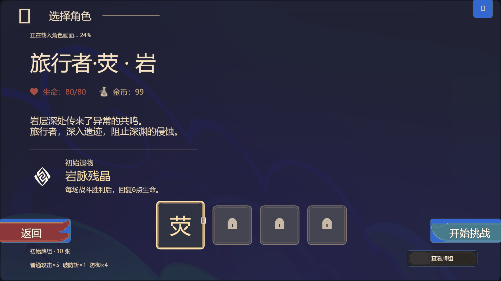
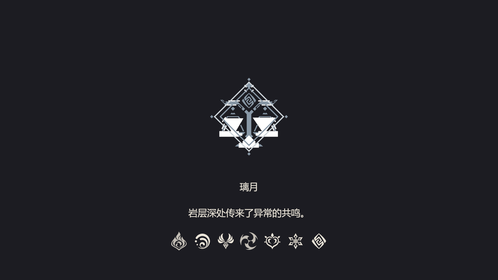

# TASK-105 璃月参考转场适配

当前为 **R4：实际准备状态驱动，静音**。用户已确认实际视觉效果没问题，反馈 R3 音效过吵，明确要求移除并留待下版本挑选。本轮删除转场的进入/结束音效调用、注入和两个专用主题键，不改视觉、字体、排版或准备状态时序。静音回归覆盖进入、成功结束和取消；其他页面音效保持原状。用户授权验证、独立复审后挂起自动合并，不等待 CI。

以下 R3/R2 记录与截图保留为视觉/来源历史；其中音频调用证据不代表当前版本仍启用音效。用户的视觉通过反馈不替代尚未采集的手机/正式 RC 证据。

R4 CI 的 hosted checkout 包为 134782769 字节，超过原 128 MiB 上限。为缩小本 PR 的证据负担，已从当前树移除被用户否定的 R1 PNG/GIF；它们仍完整保存在 [R1 历史提交](https://github.com/FurinyaWorks/Slay-the-Heavens/tree/cca6ee150250b48604a8202ef5b7a599441781fc/docs/evidence/liyue-transition)，原收据保留。R2 参考比较、完整衔接动图和 R3 最终实际画面全部保留；不放宽门禁，不改运行时代码。

用户已认可 R2 构图、原生字体样式和排版；R3 的实际候选界面读回与 R2 完全相同（控件、文本、字体、布局摘要均为 b2315b2e7b09d8730b854ff8a35ac7be2e1a14336e7f2c908165f033ffc7b7db），只调整时序/结束条件与音效。

## R3 就绪驱动与音效

不再强制等待参考演示的 8 秒。参考 [Epic 公开加载屏代码](https://github.com/EpicGames/LoadingScreen/blob/master/Source/LoadingScreen/Private/LoadingScreenModule.cpp) 中加载完成与最短显示时间分离的模式，以及 [Godot 官方后台加载文档](https://docs.godotengine.org/en/stable/tutorials/io/background_loading.html) 的真实状态检查；未引入这些引擎、插件或额外异步框架。

原 beginRun 完成实际工作时登记 UI 准备阶段：1 选角准入、2 Run/数据构建、3 表现与历史准备、4 路线生成、5 开局事件准备、6 当前 Run 发布并渲染目标页面。之后隔一个 Host update，核对当前 Run/map、当前目标页面，以及启用原生页面生命周期时该页面的 active 回读；就绪才记为 7。不读取无关的菜单背景、选角头像或后续战斗肖像状态。

七元素保留原顺序，只对已经完成的准备阶段做每元素 0.12 秒补间；未完成阶段不会提前点亮，不显示伪造百分比。第 7 阶段未就绪时不揭示目标页。准备完成且短补间结束后立即收尾，沿用 0.3 秒淡化。普通 Host 以 0.05 秒步长实跑：ready约 0.35 秒、进入收尾约 1.15 秒、完整结束约 1.75 秒。这是离线控制器时序，不是硬件加载耗时或 GPU/网络就绪认证。现有开局主要同步准备，本次不延迟其工作，也不等待不属于开局的战斗肖像。

音效复用既有 platform.sound → Theme.sound → game.PlayAudio2D：进入为原生目录 50944“切换_轻_展开_01”，成功收尾为 50945“切换_轻_折叠_01”，各触发一次。取消/失败不触发完成音；音效 API 异常不阻塞流程；没有循环声、七连提示或外部音频包。目录没有明确的原神专用转场条目，不声称使用了原版专用音效；真实音量和听感仍待用户实机确认。

验证：13 项真实 Lua Host 转场回归（快速完成、注入阶段4停留12秒、失败/取消/重试、音效次数和设备异常等）通过；目标页面 native active=false→true 专项通过，确认未读非目标资源；定向菜单/选角/开局/计时 11 项及新增专项共12项通过；check:engineering（架构、Luacheck、4项关键变异、6项原生合同）通过。112固定控件、95徽记图元、原字体和版式不变。R3 官方导入/ready/声画/设备仍待验，旧版本记录不能代替。

R3 候选 buildId：b08de2e7-7b32-48a5-8901-32e7e50dfdcf；SHA256：7e92f61aa5f5d3d1cc5ab39c0125208af4dea89bbf7e1ad8ddc6588606d1aa17。静态构建与独立读回通过，361个模块；仍采用已有 official-assets + native-page-lifecycle 转场测试配置，不覆盖远端其他PR页面。

交付路径：`F:\New folder\交付\璃月黑白转场-20261114\R3-按准备状态收尾与音效\Slay-the-Abyss-璃月转场-R3.gil`。导入为新存档，沿“启程→确认岩旅→转场→七天神像”验证，不自动发布或合并。

### R3 实际运行证据

[实际候选帧、音效事件与阶段日志](../evidence/liyue-transition/readiness-audio/capture.json)记录进入50944、收尾50945各一次，最后无存活音频。该采集使用模拟器MCP默认静音，证明调用及生命周期，不宣称已听过硬件实际听感。GIF首尾为便于查看延长停留；实际控制器在本次采集中1.75秒结束。

[实际UI读回保持一致](../evidence/liyue-transition/readiness-audio/unchanged-layout.json)；R2/R3所有元素点亮帧像素亦完全相同，保留用户认可的字体样式。[用户新结束R2日志摘要](../evidence/liyue-transition/readiness-audio/r2-official-log-summary.json)单独保留，不替代R3设备验收。

## 历史 R2／R1（保留来源与用户反馈）

当前为 R2。R1 的“单个岩图标＋两条线、0.86 秒”已被用户实机否定，不作为当前视觉方案或 GO 证据。R1 源码已实际导入并由新日志确认 build/ready，361/361 外部 Lua 与冻结候选匹配；182 条打印记录包含一场战斗胜利，未见错误打印。这只能证明来源和这段运行路径，不能推翻用户对闪现节奏及视觉删减的否定。

## R2 来源与实现

用户提供 `高仿原神转场【存档形式】.gil`，SHA256 `162a0315acb2b9683c9057654b3155cd928f129a5254f1726f2af77de1a326e0`。只读拆取其中的璃月徽记和时间设置，不导入整份存档、其节点图或其他地区。原作者与资产许可未提供，保留来源和未知权利状态，不称作项目原创或另授许可。

参考节点 7 的非循环“过场”计时器接节点 8 的时间点序列 `[1,1.5,2,4,4.5,5,5.5,7,8]`；前七点按火、水、风、雷、草、冰、岩点亮，最后 8 秒结束。标题/文本另有 2 秒循环更新，但参考文案只是重复地区名占位。本项目固定显示“璃月”和批准叙事原句“岩层深处传来了异常的共鸣。”，不引入占位文案或随机换文案。

沿用参考 8 秒总时间轴；0.3 秒覆盖原页面，原构图出现并完整展示，首尾用同一遮罩淡入淡出，7.7 秒起揭示目的页，8 秒解除输入隔离。徽记完全清晰约 6.8 秒。8 秒来自参考作者，并不是行业统一规定；成熟机制是保证最短展示时间，避免快载入导致闪现，可见 [Epic FLoadingScreenAttributes.MinimumLoadingScreenDisplayTime](https://dev.epicgames.com/documentation/unreal-engine/API/Runtime/MoviePlayer/FLoadingScreenAttributes)。0.3 秒淡化是项目原有淡入/淡出要求的接入适配，未冒充参考里存在同一数值。

源璃月白徽记模板 `1073742848` 有 116 个原生图元；只剔除完全被遮住的部分，保留 95 个。116/95 两个图形由同一 BeyondSimulator Host 直接渲染比较，实际 PNG 像素一致。没有把徽记替换成岩元素图标。布局保留原徽记、标题说明区和底部七元素。

总计 112 个固定控件，最大直属子控件 48，满足原生每容器 60 上限。95 图元拆成两个静态容器，只创建一次；每帧仅调整一个前景遮罩，七个元素只在时间点跨越时更新颜色，不逐帧遍历/重建徽记。数据和来源在 `data/presentation/liyue_transition_reference.json`；布局、颜色、时间仍在既有主题中。

仍复用 prologuePanel / abyss_prologue、Host OnUpdate、covering/opaque、原 beginRun、页面可见性和取消接口。全黑时才创建新局；菜单、下层 action 与陈旧点击回调被拦截，揭示完成后恢复原开局。核心规则、菜单美术、选角美术、房间背景和其他 PR 的实现没有写入本补丁；测试存档的旧页面不能作为覆盖远端更新的来源。

## 验证与证据边界

- R2 真实 Lua Host 转场 11 项，新增逐个执行七元素阈值、7.4/7.55/7.7/8 秒遮罩边界，并要求总时间保持参考 8 秒，防止再次压成闪现。
- 独立评审实跑相同边界，原生容量与逐帧更新范围通过。工程检查（架构、Luacheck、4 项关键变异、6 项原生合同）通过。
- R2 静态构建及独立读回通过；361 模块，模拟器转换逆向核对 0 差异。
- R2 官方新导入、当前 ready、PC/手机视觉与产品 GO 仍待用户手动实测，R1 的官方记录不代替 R2。

R2 候选 SHA256：`4a73df5ea152a8c84be63390050f8036ca8e5296e411598ec6ce590c6adaefca`。采用仓库既有 official-assets + native-page-lifecycle 测试配置，非发布候选；只供本转场验证，不代表其他尚未合并 PR 的最新页面。

交付路径：`F:\New folder\交付\璃月黑白转场-20261114\R2-参考构图与原时间轴\Slay-the-Abyss-璃月参考转场-R2.gil`。导入为新存档，走“启程 → 确认岩系旅行者 → 8 秒璃月转场 → 七天神像”。本轮没有自动发布或合并。

R1 历史模拟器帧仍保留在 `docs/evidence/liyue-transition/`，不代表 R2；该目录的原 7 控件/0.86 秒效果已被用户否定。

## R2 实际运行画面

[候选身份、原始截图收据和运行日志](../evidence/liyue-transition/reference-adaptation/capture.json)；[参考图形同条件逐像素比较及原时间轴](../evidence/liyue-transition/reference-adaptation/reference-comparison.json)。GIF 首尾停留为便于查看而延长，中间按实采时间点显示，没有延长游戏自身 8 秒时长。这是实际候选 Lua 的模拟器软件画面，R2 官方导入/设备验收保持待验。
保存的文本测试输出只规范化行尾空格，原始失败与重跑输出仍保留在本轮 .artifacts；前轮唯一失败为进程预载10项旧标记，11项Lua已全过，唯一失败组重跑后通过。
