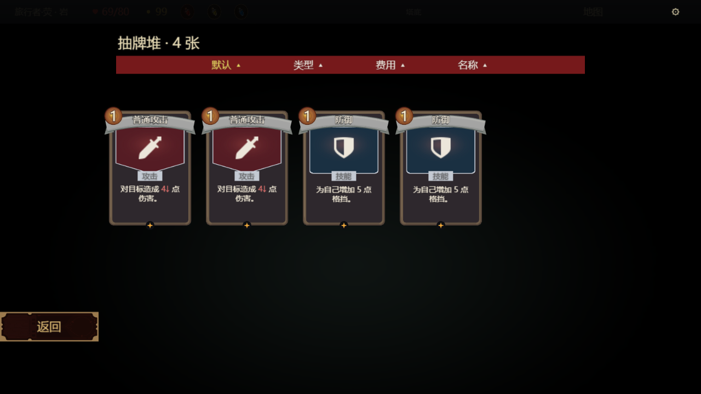
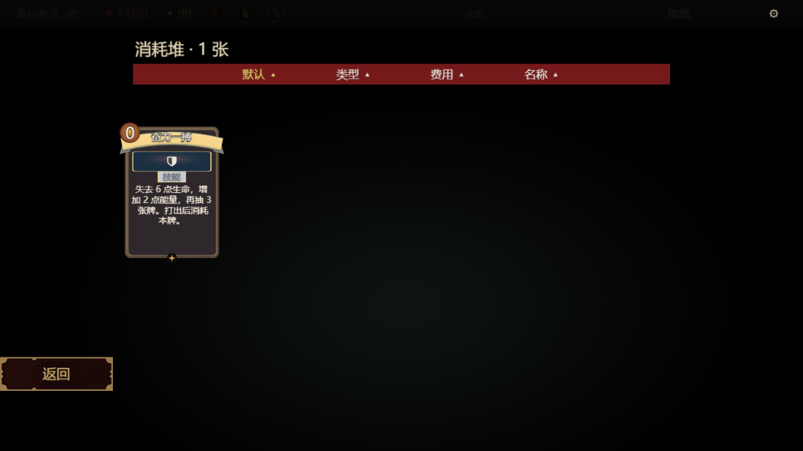

# 战斗页牌堆与遗物详情收尾

**本轮 Simulator/离线候选切片完成。** 基于用户已试玩认可的 `97b755a5`，保留战斗技术路线与出牌逻辑。本轮只处理抽牌堆、弃牌堆、消耗堆和战斗遗物详情；奖励选择页留给下个 Session。不合并、不发布、不启动原神。TASK-103 包含官方客户端等更大范围，继续 In Progress，不勾尚无证据的 AC。

本机试玩入口仍为 <http://127.0.0.1:52608/>，提供十牌/双敌/三药水和标准五牌。磁盘中断后恢复了相同 URL；进程曾重启，不能称旧运行现场始终未变。旧提交、候选及排查材料保留。本入口仅限本机，未部署公网。

## 实现与 V25 对照

直接运行并查看冻结的批准 V25 原型，依据 `sts-battle-restore.css:78,81–88,105–108` 最终覆盖规则，落实黑色柔边遮罩、左上标题与张数、红色四项排序条、五列左起卡组，以及左下返回。不是依据被后续 CSS 覆盖的早期蓝色窗口。冻结 CSS SHA256 `bee6138f43655ffc62ce0c0860bfacf6050fbae7bd702227a472c571c0e13f92`；私有原稿实际截图 `09-discard-pile.png` SHA256 `0606a2e4b85731b8b5ce63f0e6fa0c859daa288e3fe3576c1e838c2c0ea88d34`。原稿含不应公开的参考素材，未加入仓库。

- 牌堆卡牌克隆最终战斗手牌模板，保留同一 artwork、标题、稀有度、费用及战斗数字投影；只关闭浏览页不应播放的手牌荧光，不新增卡面渲染器。
- 空抽牌堆/弃牌堆也能打开并显示空状态。消耗数为零时沿用入口隐藏；真实消耗后出现原官方图标与小红色数量徽章。
- 默认/类型/费用/名称排序仅操作 UI 复制快照；默认可恢复，关闭不写回真实牌堆，不修改 Run 或 RNG。卡牌详情继续复用现有分页正文和升级预览，返回恢复牌堆。
- 战斗单件遗物详情采用现有官方深色边框，展示独立图标、名称、稀有度、效果、实时计数及前后件导航；非战斗列表保留原配色与行为。

平台差异仍明确：返回采用现有官方按钮材质，轮廓不是 CSS 不规则丝带；字体与原生 Grid 细节不同；详情是已有原生正文阅读器，不是原稿 CSS 放大卡片。原型没有完整的消耗堆和遗物弹窗，后两者沿同一风格扩展，不能称逐像素原稿复刻。奋力一搏长正文压缩插画是现有共享卡面行为，本轮未另改战斗卡面。

## 最终候选身份

- 生产源码截至 `d7ac8353c1d74f84f7c8fa161685ba73da0023cc`；构建记录为该提交加 dirty，不能改称干净构建。
- GIL build `3a928e26-af7f-4860-ac29-fd078371b0d5`，SHA256 `f60e1f4dc800ab5eb16f8abbaa85ce6d0a6f9fc0a4e15b88ef2132fd923c6b10`。
- 实际读回 save SHA256 `ffd1561311d0dcc06695f37727cb3ca78fad5f6a0571059f8368d12c2c9814f0`。候选源码字节、六个模板及读回转换收据另附。
- 压力夹具只改变启动模块 `abyss_game_ui.lua` 的准备过程及展示名；启动器完整对象比较，战斗定义、规则数据和其他 Lua 不变。夹具不是官方导入。
- 延用已有 SDK Fengari、typed 完整图快照扩展、leading16 输入合并和 Pixi 浏览器适配。不是未修改 SDK 或官方客户端。SDK 导出 SHA256 `8d10975a41285c54935d003bf68933586bd6bcf133328435ce8e944b005d94b8`。

读回适配曾遗漏 native 默认描边、Basic 默认及 `Pixel` 枚举，造成离线卡面回退；已校准并比较全部十张初始手牌完整控制树。只归一化生成 id/guid 与六种内置形状的等效 null/Basic，其余属性及子序精确相同，不能只以“未改卡面文件”代替此核对。

## 验证范围

本轮源码与实际候选验证包括真实 Offering 消耗、三个牌堆、四项排序恢复、卡牌详情往返、两件不同遗物详情、十牌双敌真实指针连出三张攻击，以及牌堆/卡库/地图往返和根清理。原始脚本、状态、日志、PNG 摘要及性能采样另附，失败样本保留。

当前最终生产源码：49 项相关运行/来源检查通过；6 项原生 UI 生命周期合同通过；工程 345 模块、5951/5951 测量、1954 依赖边，Luacheck 无新增，14 项既有显式告警。完整 Full/托管 CI、官方导入/ready、手机、官方容量、发布验收均未执行，不能从这些离线结果推导通过。

## 实际画面与交互

以下为同一最终候选、原有未加实验覆盖的 renderer、实际指针操作后的 **13 张原始浏览器画布截图**。全部保留 PNG、原始收据及压缩状态，不是效果图或组件重绘。视觉复核见 `visual-review.json`。

空抽牌堆、真实弃牌堆、详情和回到牌堆分别见 [空状态](visual/00-empty-draw.png)、[弃牌堆](visual/05-discard-strike.png)、[卡牌详情](visual/08-card-detail-heading.png)、[返回列表](visual/09-return-to-pile.png)。整页、悬停、瞄准及消耗入口见 `visual/01-whole.png`、`02-defend-hover.png`、`03-bash-centred-aim.png`、`04a-exhaust-entry-live.png`。

真实 Offering 先打出：生命 80→74、能量 3→5，消耗入口出现 1；随后进入消耗堆，核对同一张牌。真实攻击进入弃牌堆，真实结束回合后抽牌堆显示四张。所有四项排序点击后回到默认，列表卡面像素与原顺序一致；详情返回保留同一列表。SDK 循环另逐次断言实际消耗牌 UID，未用预填的“消耗堆 1 张”代替出牌。

排查过程有一次重要误诊：重复查看图片时，我把工具展示差异判断成返回/文字漏画。原始像素反证否定了该判断：七种窗口的返回按钮区域逐字节相同；抽牌、默认排序恢复、详情返回的四卡区域也完全相同；原 renderer 连续十次绘制输出 PNG 哈希全部相同。证据见 `visual-pixel-check.json` 与 `original-ten-frames-trace.json.gz`。内部拼图复核再次确认画面完整；拼图未冒充原始截图交付。所有试验性 renderer 改动均未采用，正式启动器仍钉住原 `5971287f…`。不能把那次误诊写成已修复的游戏/GPU 故障。

## 性能回归与资源清理

采用同一 SDK、同一 GPU、十牌/双敌/三药水；顺序为旧→新→新→旧，每组重新启动服务并只跑一个 QA 会话，避免跨组累积测试存档。计时期间不截图、不录屏，不并行跑其他本任务重测试。旧组取 `97b755a5` 已试玩入口使用的实际 `52aee9f0…` 存档；新组取上述最终候选。脚本、原始四组报告、机器空闲内存记录均附 gzip，摘要为 `metrics-summary.json`。

| 实际浏览器指标 | 旧组两轮 | 新组两轮 |
| --- | --- | --- |
| 拖动输入→首次绘制变化，中位数，各 8 次 | 40.2 / 62.6 ms | 42.1 / 75.3 ms |
| 上述全部样本范围 | 37.7–146.8 ms | 34.5–99.9 ms |
| 48 个连续移动事件的实际墙钟 | 1.241 / 1.434 s | 1.098 / 1.718 s |
| 松手→飞牌首帧，各 3 张 | 156.2–236.7 ms | 136.3–339.0 ms |
| 松手→HP 绘制变化，各 3 张 | 227.4–317.7 ms | 190.1–439.0 ms |
| 归档加载 | 8.54 / 10.16 s | 8.41 / 9.64 s |
| 页面导航→观测到正帧 | 9.15 / 10.74 s | 7.97 / 7.08 s |

GPU 为 Intel Iris Xe / ANGLE D3D11。输入指标取实际 renderer 完成场景绘制后首次卡根变化，**不是显示器扫描延迟、设备 FPS 或官方客户端读数**。两组均实际拖动、取消保留十牌与能量，再连出三张 Strike：手牌 10→7、能量 3→0、敌 HP 32→14；均无 pageerror，显式停止成功。连续移动由既有 leading16 合并：旧两轮转为 38/33 次请求，新两轮为 35/28 次，不能把事件数当帧率。飞牌/伤害含既有动画节奏；新组保留了 339/439 ms 的慢样本，不宣称零延迟或用两轮小样本证明提速。此前积累多会话的较慢样本另附，不混成此表，也不把差异全部归因于会话积累。

最终同候选 SDK 整页回归实际初始化、十牌双敌、持牌/取消、连续出牌、真实消耗、结束回合，并各跑 **20 次弃牌堆、消耗堆、抽牌堆、普通卡库和地图往返**。暖态控件数始终 **13,812**，根销毁后 **0**；faults=0，输入来源未变。CPU step 共 1,060 次，P50 **10.23 ms**、P95 **25.33 ms**、P99 **57.11 ms**、最大 **149.02 ms**。SDK 冷初始化 **3.17 s**，独立于上表浏览器加载。它们是解释器 CPU 与控件生命周期数据，不是 GPU FPS、零内存泄漏证明或官方容量读数。

本轮结论：**牌堆与遗物可以在现有官方素材/原生控件路线中完成，不需要回到 PNG 数千图元重建；现有战斗手感应保留。** 当前浏览器与 SDK 的响应仍有波动、首次加载仍需等待，数据不足以承诺所有设备“毫无延迟”。官方客户端、手机和官方容量继续未验证，不据此授予发布许可。
