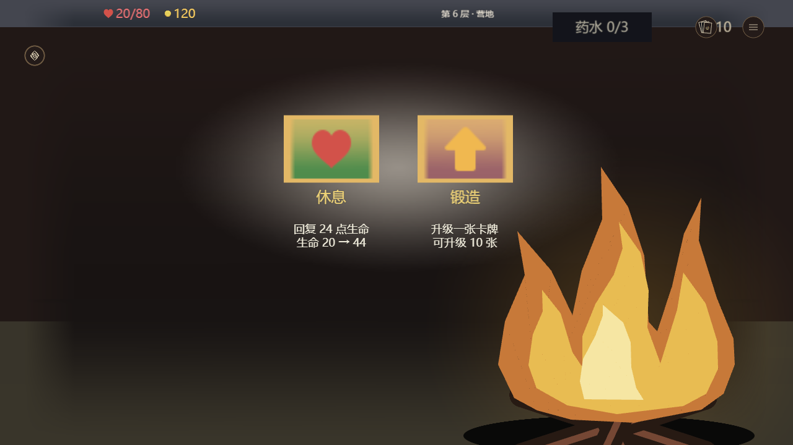

# 地图事件与房间 V25 实际证据

> **Owner已否定本页旧版视觉接近度，AC1已撤回。** 以下保留为当时源码/事务及截图记录，不能再用于宣称批准稿美术验收通过。返工按冻结设计逐屏校准；技术检查和资源释放证据与视觉接近度分别判断。宝箱造型按Owner最新指示保留，只修领取按钮等可读性。最新返工检查点将记录在 revision-2/。

TASK-103.2，2026-11-10。独立 `feat/event-v25` 工作树继承 #603 地图、#582 生命周期；没有改 #588 正在开发的战斗页面、事件规则、价格、奖励或 RNG。此次是已有事件的呈现与交互完善，不是新增事件内容。普通主题保持原状，改动仅用于 `v25BattleChrome` 候选，不能据此声称 #588 official-assets-first 分支自动具备同样效果。

## 实际画面

主代理和独立审查者逐张查看下列最终 Simulator/Pixi 截图。使用真实源模块、真实节点事务和官方静态素材；没有 PNG 拼接重建、DOM 仿制或私有批准稿素材再分发。类别图章复用现有素材，不宣称为事件专属插画。营地/宝箱等已有 V25 层次继续复用，仅修实际发现的问题。

| 画面 | 本轮检查 |
| --- | --- |
| [圣职者](cleric.png) | 叙述与纸带分列，治疗费用及生命预告 |
| [设计师](designer-four-options.png) | 四选项完整、文字空间、标题和费用 |
| [长药水说明](we-meet-again-long-potion.png) | 完整两行，包含溢出丢失及战内限制，禁用说明可读 |
| [图书馆选牌](library-picker.png) | 真实20张候选分页、强制选择 |
| [商店](shop.png) | 原商品池、价格、删牌；遗留黑圆消失，图标/名/价分开 |
| [营地](camp.png) | 原生分层火焰、休息与锻造预告 |
| [打开宝箱](treasure-open.png) | 原生箱体及独立奖励项 |
| [开场恩赐](neow-blessings.png) | 特殊按钮尺寸及气泡内文字 |
| [实际翻牌](match-reveal.png) | 原12格、1张实际揭开，保留输入所有权 |




## 真实事务、连续操作和资源

源生成完整 GameUI save SHA256：`afee98a1405542adcacd82906b5e02808623671425b526375f9d2d176097fffd`。SDK SHA256：`8d10975a41285c54935d003bf68933586bd6bcf133328435ce8e944b005d94b8`。完整回放与特殊页分别见 `sdk-replay.json.gz`、`sdk-special.json.gz`；模块身份在 `integration-source.json.gz`。

- 26个主场景、9个特殊场景，实际 SDK 指针派发；圣职者支付35治疗并回地图、图书馆选牌确认、设计师支付90并强制删牌、商店选货、营地锻造、宝箱打开、翻牌进入/揭牌。
- 20次“测试节点进入→实际治疗→返回地图”，预热控件恒定 **17,310**，销毁后 **0**，Lua错误 **0**。
- 最后一次20循环 CPU 墙钟：P50 **1,219.08 ms**，P95 **1,758.83 ms**，最大 **1,938.04 ms**。每循环包含复制完整测试数据、创建 Run/Map、指定夹具、多个指针/更新及状态断言；这是带测试布置的完整事务成本，不能当成点击延迟或帧时。
- 120个增量更新及 hover/down/cancel 预览前后，对比地图、资源、牌组、节点和 RNG 状态不变。正常递增的计时及展示时钟不在此快照范围。save/SDK输入哈希稳定。

这些事件使用 seed42 和显式 encounterId 测试输入，仍由真实 Nodes.enter/原事件实现结算；不是自然遭遇概率证据。完整 GameUI 回放不同于下面的紧凑交互预览。

## 浏览器与性能边界

最终图来自 Chrome151 的实际 Simulator Pixi 画布，等待全部 sprite promises 后再渲染截图。`browser-main.json.gz`、`browser-special.json.gz` 记录素材及页面错误均为空；静态截图批次使用 SwiftShader，不能作设备帧率结论。

另一次默认硬件后端为 **ANGLE / NVIDIA RTX3060 Laptop / D3D11**，宝箱结果页114个场景节点，120个匹配基线的 `reset=false` sceneRev 增量：实际 `applyScene + app.render` CPU P50 **0.20 ms**、P95 **0.60 ms**、最大 **1.80 ms**。`browser-performance.json.gz` 保存全部样本。

该页首次完整投影 **1,438 ms**，其中等待9种素材 **1,184.7 ms**。起点是已有 SDK 场景提交给浏览器，不包括 SDK 初始化、模块加载、上传或官方客户端 ready；不能拿它代表端到端首次启动。静态页稳态增量也不等于切页峰值、战斗负载、GPU帧率或手机性能。

## 可交互预览

[本机 Web Simulator](http://127.0.0.1:4186/editor/play#event-v25-final)（服务运行时可用，仅本机地址）。底部七个“测试·…”按钮会重置测试场景；原事件选项、购买、锻造、选牌、翻牌仍执行真实规则。完成房间后可查看真实地图快照，此紧凑预览的地图只读，不包含战斗页。

`web-report.json.gz` 记录实际 Web 页面指针验证：治疗金币120→85、设计师四选项、七个导航入口、页面错误0。完整 GameUI/返回地图与同局状态以 SDK 回放为依据，不能用紧凑夹具替代。

## 修复与回归

- 事件四行88高、间隔6，完整保留费用与效果；V25仅压合药水说明第一个换行，不删限制文字。
- Neow保持原特殊构图，底材和边线跟随593×80运行时尺寸；文字缩入气泡。默认主题无这些写入。
- Match原来向 Image/Text 写 `raycastTarget=false`，真实 SDK 拒绝。删除非法写入，保留原 CursorArea。严格mock先清原始字段并复制独立metatable，恢复旧写入负控失败、当前5项通过。
- 预览转换器此前把352个填充都写Left，造成原生三角半边方向不符，营火破碎。修为按实际 `fill.from` 映射；新测试真实生成完整 save，逐路径校验方向与比例，防止用错误预览反过来误改业务素材。
- [相关9项集成/布局测试](related-tests.txt)通过；Match5项、syntax、guidance、Backlog、平台日常负载及[Lua静态检查](lua-static.txt)通过，未新增历史豁免。
- 本地 `npm run check` 全量曾启动，交付检查点仍未完成；不报 Full 通过。合并所需 CI 必须单独完成。本专项不设置自动合并、不发布。

独立审查：[记录](independent-review.md)、[源文件身份](reviewed-sha256.json)、[截图身份](reviewed-screenshots-sha256.json)。两项P2（标题重叠、严格mock盲区）已闭环；最终9图独审无新增P1/P2。

## GIL 副本与未验证项

构建ID `a273e7b1-f173-4a3f-8d40-a92b29138e43`；GIL **17,079,458 bytes**，SHA256 `048c75cf672356b066c53d3a76de6bd81d570763f3effb760224e0d2ae88a58d`。本机交付 `F:/New folder/交付/地图事件专项/地图与事件-V25候选.gil`，同目录有 candidate.json。正式构建收据见 `candidate.json.gz`，仅写副本，live-write=0。

候选已实际编码、写入/读回并通过原生静态检查；SDK证据来自上述源生成 save，**不是该 GIL 的读回回放**。基底是 #588 既有导入副本，不同步其正在开发的后续提交。

**官方导入、当前候选真实 ready、官方容量、PC/手机实机均未测试。** `verify:ui` 因缺同候选 startup-evidence.json 未通过；没有制作虚假 ready 或放宽验收。美术接近度仍受官方字体、纹理与素材实际可用性影响；这里证明的是最终 Simulator 呈现与所列交互。普通PR可评审，不能当作RC/发布许可。

## 复现

使用工具链中已有 SDK/export 与 Simulator 服务路径，避免另装或修改 #588 目录：

```powershell
node experiments/art-tech-lab/map-game.mjs .artifacts/event-repro
node experiments/art-tech-lab/event-game-measure.mjs .artifacts/event-repro/game.save.json <actual-session.mjs> .artifacts/event-repro/replay
node experiments/art-tech-lab/event-game-measure.mjs .artifacts/event-repro/game.save.json <actual-session.mjs> .artifacts/event-repro/special --special-only
python experiments/art-tech-lab/event-state-browser.py .artifacts/event-repro/replay .artifacts/event-repro/browser --canvas-png --names=camp,shop,treasure-open,cleric,designer-four-options,library-picker
node experiments/art-tech-lab/event-web-preview.mjs .artifacts/event-repro/game.save.json .artifacts/event-repro/web.save.json --rooms-only
```

截图脚本需要已有本机4180素材服务；Web脚本使用独立4186服务。图形性能重放用 `--names=treasure-open --frames=<对应treasure-open.frames.json>`，不得跨场景套增量。测试文件与工具参数注释包含边界，不写入正式游戏状态。
