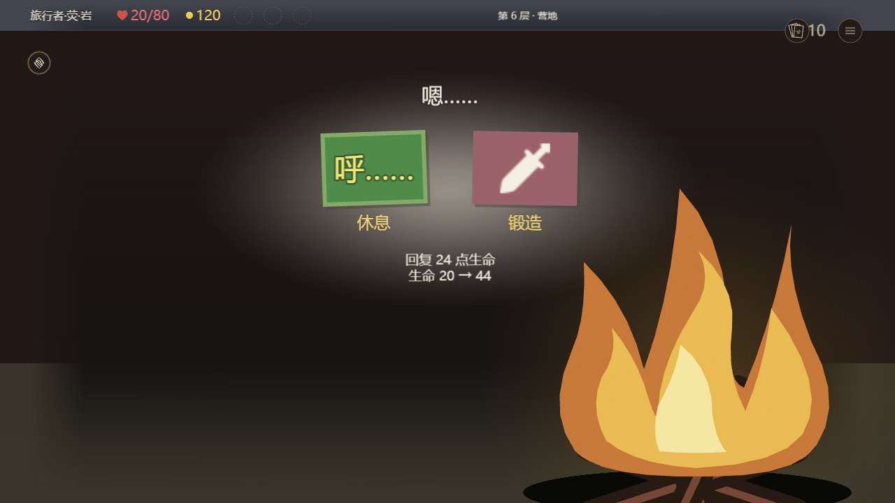

# 地图事件与房间返工检查点

TASK-103.2 / Draft PR #605。上一版视觉结论已撤回，本轮 **AC1仍未完成**。以下是实际改进及证据，不是批准稿整体美术或官方设备验收。

## 实际画面

主代理及独立审查者亲看了这四张 Simulator/Pixi 实际截图；未公开私人冻结设计截图。没有把 PNG 切块重建为原生 UI。

| 画面 | 本轮修正 | 仍存在的差异 |
| --- | --- | --- |
| [事件](cleric.png) | 长纸带、淡问号、700×44窄选项、底对齐、费用红色及奖励绿色；取消自加圆形图章 | 原生字体、正文行距、共享HUD右侧排列 |
| [商店](shop.png) | 原生纸面107253、费用章107270、弯曲折边横幅；裸小物品、两行金字删牌服务 | 卡面材质、边框厚度及字体仍与稿不同 |
| [营地](camp.png) | 正确牌面旋转、共享效果说明、原生曲线火焰及明暗层次 | 缺完整人物立绘，字体不同；不得称为完整还原 |
| [宝箱](treasure-open.png) | 按用户意见保留箱体；领取文字改清楚金色，独立奖励完整显示 | 字体及共享HUD仍有差异 |




## 同源运行和性能

R4源生成完整GameUI save SHA256 `e07299b7750b3a04bb08fa9575bbf282330fa1a93446ed19d8398bc53b209387`。实际SDK为仓库现有export，身份及原始日志在压缩报告内。不是GIL读回回放。

- [SDK完整回放](sdk-replay.json.gz)：26主场景、20次真实指针事务、120增量更新。预热控件18,289稳定，销毁后0，Lua错误0。真实费用奖励、选牌及返回地图断言通过；显式seed/encounter夹具不代表自然遭遇概率。
- [特殊场景](sdk-special.json.gz)：9场景，包括长药水说明、开场恩赐与真实揭牌。
- [浏览器实际渲染](browser-render.json.gz)：等待全部素材请求后截图，页面/素材错误为空。
- [营地硬件测量](camp-performance.json.gz)：Intel Iris Xe / D3D11，520场景节点；首次投影加素材等待2,004ms，其中素材等待1,493.4ms。120个静态sceneRev增量的Pixi应用及render提交CPU P50 13.2ms、P95 15.3ms、最大26.3ms。该起点不包含SDK启动/模块加载，不是GPU帧率、真实切页延迟或手机性能。结果仍有优化空间，不能沿用旧宝箱0.6ms冒充当前营地性能。

## 完整交互预览

[本机 Web Simulator](http://127.0.0.1:4190/editor/play#event-full-r4-user)。完整GameUI保留公共HUD、药水管理、卡组、地图及原房间规则。底部七个测试按钮明确重置夹具；正常房间选项继续执行真实事务。用户会话与自动测试会话隔离。

[实际Web报告](web-full.json.gz)：指针打开/关闭药水管理、治疗金币120→85、房间返回真实地图、打开宝箱后独立奖励可见，页面错误0。总测试耗时包含布置/等待/截图，不能当作点击延迟。

该独立4190预览复用只读Simulator bundle及Node24，分帧启动；仅本地实验host把原worker8秒、前端15秒请求预算改为120秒，未修改上游bundle或#588文件。它证明加大实验预算后的可交互性，不能据此宣称默认启动性能达标。4186紧凑入口是旧组件夹具，不能代替本次完整预览。

复现时用新输出目录及独立session ID，避免重置用户会话：

```powershell
node experiments/art-tech-lab/map-game.mjs .artifacts/event-repro-new
node experiments/art-tech-lab/event-web-preview.mjs .artifacts/event-repro-new/game.save.json .artifacts/event-repro-new/compact.save.json
node experiments/art-tech-lab/event-full-web.mjs .artifacts/event-repro-new/game.save.json .artifacts/event-repro-new/compact.save.json .artifacts/event-repro-new/full-web.save.json
# 用已有Node24及只读Simulator dist/server.js，另选空闲本机端口：
node experiments/art-tech-lab/event-full-web-server.mjs <readonly-server.js> .artifacts/event-repro-new/full-web.save.json <port> 120000
python experiments/art-tech-lab/event-full-web-browser.py .artifacts/event-repro-new/full-web.save.json .artifacts/event-repro-new/web-check http://127.0.0.1:<port> event-repro-auto
```

## 并行隔离与复核

房间专用配置从 `v25Battle.layout.nativeNode` 移至顶层 `v25Nodes`，由V25房间候选单独合入。#588真实 `officialAssetsTheme` 按battle配置键枚举，因此不再意外带入房间专用控件依赖。没有修改#588工作树或其药水文字。

[隔离比较](profile-isolation.json.gz)：隔离前后全部生成控件/模板字节相同，有效运行主题深相等；源profile元数据位置变化导致theme Lua与save哈希变化，不能宣称save字节相同。[新源SDK基线](isolated-sdk-baseline.json.gz)再次通过3事件场景及释放；圣职者实际scene nodes与R4逐项相同。本次没有重复冒称20循环重测。

[相关14项回归](related-tests.txt)通过，包括原房间事务、共享药水槽、批准几何及并行profile隔离。[独立复审](independent-review.md)、[复审身份](reviewed-sha256.json)明确指出立绘、字体、HUD及材质缺口，不以功能或无新增P1/P2替代美术验收。

CI另发现历史component源码检查仍把live文件直接比较旧冻结提交，继承地图及房间已有三个owner变化。新增精确room后继epoch，保留旧档案/严格历史原文断言及完整授权闭包；22源码绑定真实已提交fbe7051，组合历史proof不冒充完整已提交树。[第二代理独立复审](epoch-independent-review.md)及20项合同通过，包含所有owner暖后漂移/缺失负控；不代表Full CI通过。

立绘能力另经只读复核：项目批准PNG本身为完整1024×1536，现有importer的图片接口只写数值StaticReference imageId，没有验证过本地PNG→单Image资源导入。已有低负载荧UI实际为42个基础矩形拼像，世界荧资产也不是UI控件，故没有冒充符合本轮路线。缓存图库不能代表当前官方编辑器全部能力；仍需在获授权的官方编辑器窗口检查最新资源选择器/角色展示控件。本轮未操作用户桌面。

## 存档副本

[候选收据](candidate.json.gz)，构建ID `dde2d0a1-1fa8-4f4f-96d3-77da7aa30b77`。17,869,862 bytes，SHA256 `4d3ec1ebd60aba6189439cf0b5c46da2aeaf21927e704098cbff7e24cd7e6580`。本机文件：`F:/New folder/交付/地图事件专项/地图与事件-V25返工检查点-R5.gil`。

已实际编码、写副本、读回及静态检查，live-write=0；收据如实记录基底提交及未提交输入身份。**官方导入、同候选ready、容量、PC与手机实测均未进行**，不是RC或发布许可。整体视觉仍在返工，PR保持Draft，不自动合并或发布。Full CI未通过，不将取消或部分检查记为成功。
