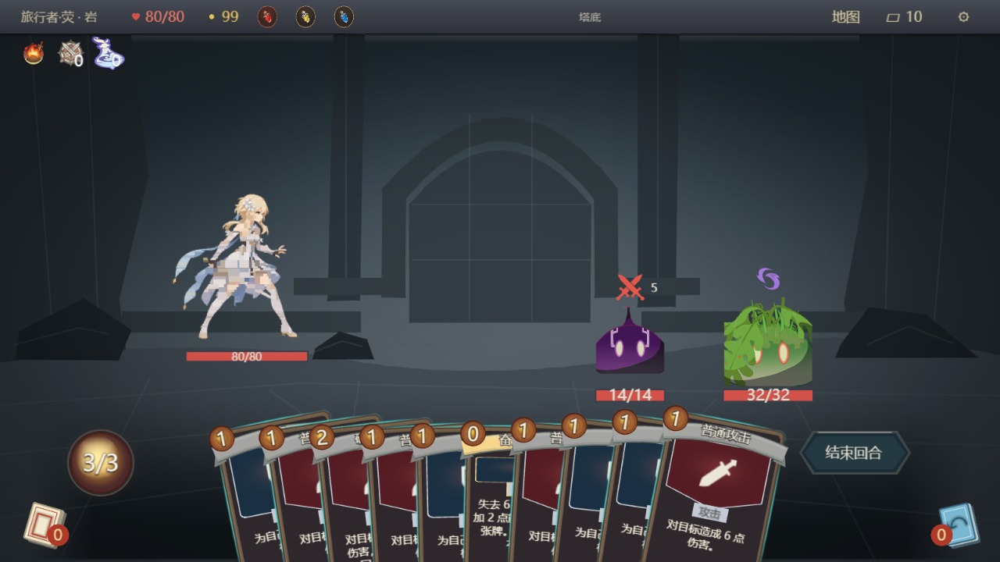
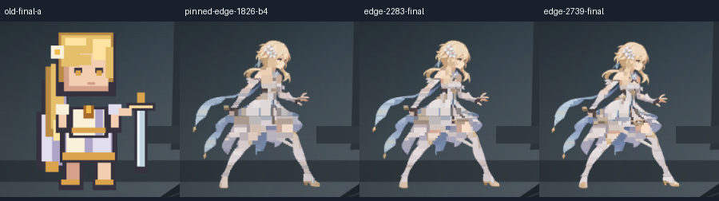
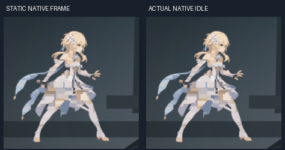

# 荧原生待机：2283／2739 图元可试玩收敛候选

关联 TASK-25.2.1、Draft PR626，依赖 PR621。主试玩：http://127.0.0.1:62685/ 。实际画布1280×720，正常拖牌、取消、攻击与牌堆功能保留。正式旧皮肤未替换，未合并发布。

## GO／NO-GO

**可试玩与Owner画质验收：GO。正式替换及多角色规格：NO-GO。** 2283作为较低图元预算档，2739作为画质对照；独审认为两档均明显优于旧57，脸、花饰、轮廓和持剑关系可辨，2739衣裙层次更多。仍为简化质感，不代替Owner批准。

恢复旧版交互的目标未稳定通过。早期edge2283／2739输入中位为67.85／53.70ms，最终穿插复测为133.40／100.00ms；没有只保留较快轮次，也不把图元更少等同于必然更快。正式旧皮肤继续保留，任务维持In Progress，PR继续Draft。

## 本轮验证与最终配对

完成27组有效独立测量，另保留1次探针假设失败。相同十牌、双敌、三药水场景，每档新backend、实际GIL读回、相同SDK与指纹renderer；性能轮不截图。最后顺序为旧 → 2283 → 2739 → 旧，四组最终运行时输入摘要相同。共享主机负载波动明显，不把这些小样本当作严格性能置信区间。

| 最终复测 | 旧57前 | 2283主试玩 | 2739画质档 | 旧57后 |
|---|---:|---:|---:|---:|
| 角色拥有控件 | 59 | 2329 | 2792 | 59 |
| 整页暖态控件 | 13812 | 16082 | 16545 | 13812 |
| 创建至完整发布SDK墙钟 | 263ms | 2003ms | 1982ms | 195ms |
| 稳态SDK step P50 | 9.53ms | 10.49ms | 9.13ms | 10.01ms |
| 浏览器render()墙钟P50 | 11.40ms | 24.15ms | 16.90ms | 11.40ms |
| 输入→实际绘制P50 | 90.15ms | 133.40ms | 100.00ms | 60.40ms |
| 输入→实际绘制P95 | 109.48ms | 168.55ms | 124.40ms | 80.51ms |
| 固定移动：发送完成／DOM送达／位置变更 | 48/32/21 | 48/42/13 | 48/48/11 | 48/43/15 |
| 实际送达跨度 | 883ms | 775ms | 777ms | 804ms |
| 2秒band setter／新建控件 | 0/0 | 152/0 | 152/0 | 0/0 |
| 根清理后控件 | 0 | 0 | 0 | 0 |

固定移动目标60Hz，实际事件会被浏览器合并，送达跨度与发送抖动全部记录。位置变更不是GPU FPS；最后观测位置的延迟也不证明最终目标已绘制，endpointVerified保持false。两档均完成原探针的取消及3次真实攻击：手牌10→7、能量3→0、敌HP32→14，无pageerror，结束成功。

首次显示仍有明显成本。上表是SDK创建/初始化/发布的墙钟；带inspect轮询探针的浏览器观测，在首个正帧后至人物可见分别为旧2.32/1.94秒、2283为12.12秒、2739为17.55秒，包含镜像、排队与取证负担，不冒称无探针的首次像素显示时间。不能用SDK纯step接近旧版掩盖这项差距。

剩余瓶颈已不只是待机Lua调用：setter下降后，浏览器渲染提交与交互链路仍明显增加。render()并非GPU timestamp，未将剩余成本归给某个未经profile的官方引擎函数。[三态消融、完整搜索步骤与未来预算依据](DIAGNOSIS.md)；[全27组表](table.md)、[机器数据](measurements.json)、[失败记录](failures.json)。

## 美术与动作的取舍

从7303减半至3652→1826→913，再固定保留脸花484个span，探索1369/1826/2739/3195/3652。低档脸部损失和衣裙横条均保留真实截图。最后沿原图像素边界选择最佳二分，使edge2283进入可试区间，AI建议下限暂收窄为(1826,2283]。这不是Owner批准下限，也不是未来怪物的生产预算。

资产画布始终210×192，没有再把全图降为133或96。既有3439/133px和768混合图元结果直接复用，见[第一轮证据](../lumine-native-idle-20261111/README.md)，没有重跑或改写它们。唯一视觉源的原始PNG/GIF字节未改，不重新设计人物，不扩展攻击动画。

静态图片缓存只创建一次，18个运动父容器降为4个，按20次/2.2秒采样，实际2秒setter由2160降为152，约减少93%；2283图片较7303减少约69%。使用批准动作场的一阶近似，不是GIF直接导入或逐帧精确复播。原攻击、受击继续驱动整体移动与特效。

主候选21张实际PNG推进模拟时钟2.2秒；脚部两个裁切区域均0通道变化，本轮严格脚部像素检查PASS。首尾人物裁切仍有17个通道值变化，没有声称完全像素闭环。[像素与时钟记录](visual-measurements.json)。第一轮脚部FAIL仍保留，不追改历史结果。

## 给未来自绘怪物留余量

主档直接复制到荧加2个怪物会是6849张图片，加3个怪物为9132张；按同样缓存层次估算整页约20740／23069个存活控件。数量已接近或超过本轮单荧7303的高成本量级，不能据单荧可试放行规模化。

下一轮场景验证暂从全场自绘图片约1500–2000的研发目标起步，按主角重要性分配，3主体均分约500–670、4主体约375–500；**不是已验收安全上限**。当前荧画质仍需约2.3k，本路线尚未证明这个余量目标。未来创建还须共享整场预算，不能把每角色64调用/8ms简单复制成多份。[算术预估及假设](future-scene-budget.json)没有外推延迟、FPS或官方容量。本轮未实施怪物。

## 身份与验收边界

主GIL build `48e1cd09-bd22-4a86-ba43-e6e74ad40792`，SHA256 `ba2a1b72fb0c6d327bb0eb79bfd7de1cdf0cea184f560c9884431ceb262a5a40`；361个Lua逐字读回，实际UI反向核对无fault。它是明确记录父收据和实际输入的dirty experimental overlay，不冒称干净HEAD的标准发布构建。Simulator仅包装启动准备，GIL保留正常游戏入口与规则。

当前Lua相关回归69/69、工程门禁、关键变异、原生UI生命周期、正式打包日常负载、Backlog、guidance及脚本语法检查通过。quick SDK不重复第一轮20次牌堆往返，不将历史结果冒作本轮新跑；当前浏览器每档仍实际取消并打出3张攻击。汇总器重新验证GIL、save、资产输入、转换收据与截图摘要，拒绝覆盖资产后错贴历史结果。

官方导入、当前候选官方ready、官方PC/手机、官方容量，以及Full/精确合并准入均未验证。SDK与浏览器数据不能替代这些验收。保持MILIASTRA_ALLOW_LIVE_WRITE=0；不占用物理键鼠，未擅自发布。

复现与工具边界见[实验入口](../../../experiments/lumine-idle/README.md)。每case保留实际battle.png、压缩原始报告、实际探针和收据；完整截图序列及GIL副本在本机交付包。源素材、项目LICENSE和既有第三方授权延续，未打包分发SDK。
