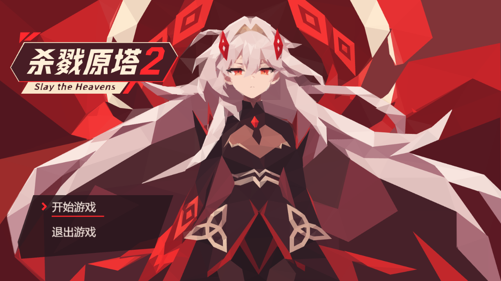

# 最新参考主菜单收尾

背景仍为96219b31批准的menu.png，背景数据、人物及构图未改。最新附件只指导标题与按钮，原附件保存在本任务.artifacts/menu-finish/latest-reference.png，其SHA256见menu-title-mark.json；原图不进入运行时。

离线title-mark.py仅描摹限定区域：378个静态三角还原中文标题、红色2和Slay the Heavens。牌形、字形、分组及回退合计416控件，最大50子项；整菜单较批准版新增444控件。按钮共享暗托底、红箭头/下划线四态，沿用固定命中及80ms/60ms悬停，无新增Lua、纹理或循环动画。标题/托底置于两个原按钮之前，结果页沿原机制隐藏。

本图为实际Simulator源预览：背景沿用原GIL读回，标题按钮由本轮布局生成，不是新官方导入或手机截图。身份见runtime.json；composition.json断言背景子树逐字节一致，背景仍1732控件。

布局/输入8项、Lua hover及菜单41断言通过；同候选SDK悬停、20次返回背景同对象及自然首战见hover.json/cache.json。无页面错误。

title-cost.json复用既有测量器，仅构造titleMark；scope的background字符串沿测量器参数，backgroundControls=416实际指标题。创建20.76ms、更新P95约0.0018ms、RSS差3.07MiB。堆差为负属GC噪声，不称内存节省。仅本机SDK样本，不是GPU/官方/手机性能。初轮整游原/新样本SDK创建1361/1456ms、更新P95 5.51/6.91ms存在波动，不宣称零开销或性能达标。

来源登记沿已有生成器保留历史。正确基底由PR661承接（原643以consolidation关闭），未合develop；依赖落地后提小PR。Hosted Full、官方及手机未验，不标Done。
