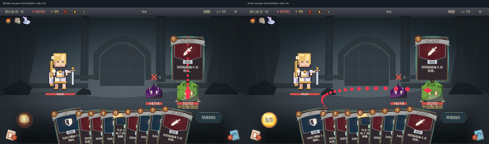
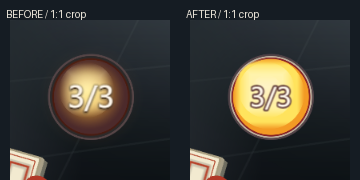

# 官方手机锁敌 / 能量球修复候选

TASK-30、TASK-4.22。**源码与本轮 Simulator 可见范围 GO；官方客户端、实体手机与发布 NO-GO（待验），不是已完成实机验收。** 独立分支 `feat/official-mobile-aim-hud`，保留正式旧皮肤，不涉及 #626。

基于 `develop@3a061a76`，保留在途 #621 的战斗切片 `680be9c5`。实际运行代码 `9cece5dc8a0040139449f056a24ce98f275c4f4f`；后续证据提交不改变候选载荷。#621 仍是合并依赖，不自动合并或发布。

## 根因与最小修复

- **手机箭头：** `GetUIPos()` 的画布坐标与 `localRotationZ` 写入均符合官方文档。真正的问题是触屏牌面上抬 `270×scale` 后，官方箭头仍从抬起牌的顶边出发，而目标在手指/敌人处，形成向下折返的竖线和朝上箭头。官方触屏改从本次抓牌的原位置出发；保留抬牌、触点归属、命中判定、玩法和旧星链分支。快速触屏模式不推进每帧重定向插值，故换敌改为直接落到当前目标，避免停留在旧终点。
- **可见尖端：** 原代码把箭头容器中心放在终点，实际尖端另有 `4+26/2=17` 单位偏移。现在按旋转和锁定缩放反算容器位置，实际尖端落在目标中心；20段原池复用，无逐帧创建控件。
- **能量球：** 实际官方布局已是 V25 的86尺寸/29字号，并非旧属性测试中的100/40。偏暗的染色材质堆叠和重复数字阴影使画面显粗。保留位置/尺寸，以6层固定原生圆面恢复奶油金、橙色与细边；数字26号、单连续描边，隐藏重复阴影但保留其写入句柄。零能量/溢出写入与显隐逻辑保留。

V25 来源为既有批准稿 `sts-battle-restore.css`（SHA256 `bee6138f43655ffc62ce0c0860bfacf6050fbae7bd702227a472c571c0e13f92`），私有原稿只在本地对照，不随本PR分发。26字号是依据本次Owner对原生字形的反馈做的最小适配，不声称像素等同。

## 实际画面

均为同一工具版本生成的真实 **1280×720 Simulator 战斗画布**，不是离线矩形图或原神截图。

[完整HUD修复前](hud-before.png) / [修复后](hud-after.png)；手机模拟画布：[锁定第一敌](touch-after-lock-first.png)、[换第二敌](touch-after-lock-second.png)、[自由瞄准](touch-after-free.png)、[取消](touch-after-cancel.png)。原竖线在旧源码反事实场景中真实复现，源码身份见 [before-counterfactual.json](before-counterfactual.json)。

修复前HUD来自一次因打包中源码变化而被构建器正确拒绝的诊断副本，**不作为可交付候选或当前源码通过证据**；原失败保留。本轮最终GIL重新从干净提交构建成功，未绕过打包门禁。读回适配器仅规范化关闭自动字号时无效的minFontSize字段，仍严格核对开关与生效字号；最终反向核对0差异。

## 漏检与回归机制

1. `aim_visual_parity.lua` 原来仅执行默认主题的14颗菱形/圆环，未执行官方20段复合箭头，也没断言可见尖端/方向。旧分支测试保留；在既有 `official-assets-runtime.test.mjs` 中新增**当前构建器生成的官方layout/theme + 真实Host回调**矩阵：鼠标/触屏 × 3画布 × 快慢，共12组，覆盖双敌、自由瞄准、锁定、直接换敌、回手取消、颜色、链条方向和可见尖端。恢复旧抬牌起点、恢复中心头定位两个负对照，均被指定几何断言拒绝。
2. `approved-energy-orb.test.mjs` 原来只锁默认旧皮肤属性与数值逻辑，无法证明官方分支的实际材质/字形。明确其配置/行为边界，另测当前官方生成布局与0/3/7能量写入，并提供本目录实际画面及独立复审；不把配置测试改名为视觉通过。
3. 复用 `verify:ui`：增加 `battleHud` 实际画面质量与V25层级评审，增加 `battleMobileAim` 多敌、自由瞄准、锁定、换敌、取消、方向与可见尖端检查。正式画面明确 `captureSource: official-client`，手机项要求 `phone/touch/deviceModel`；Simulator来源、缺项或PC/鼠标替代手机必须被拒绝。最终仍需可信同候选启动证据和人审，文件/布尔声明本身不能证明画质。

## 验证与性能边界

- 工程：345模块、5972项测量；架构、Luacheck无新诊断（14条既有显式历史项）；日常平台负载、指引及Backlog检查通过。不是官方容量读数。
- 旧星链、能量行为、官方布局/可读性、V25 chrome、证据门禁、预览专项：32通过、1个既有可选跳过。
- 当前官方运行时整轮23/24通过；原有多卡single-hit案例在低可用内存下触发原30秒超时，单独重跑一次仍超时。停止本轮临时Simulator进程后，**不改测试、超时或断言**，同案例22.5秒通过。初轮、失败及隔离重跑全部保留，不能写成初轮24/24。
- 新12组矩阵、0/3/7写入、两个原错误负对照通过；另有真正的Simulator `TOUCHSCREEN/Mobile`、CDP触摸输入画面，包含双敌锁定、换敌、自由瞄准与取消。**不等于实体手机触屏。** 0/7目前是运行时验证，不扩大为该状态的画质已验收。
- 取消后重新抓牌并锁敌释放的独立触摸冒烟通过：十张变九张、3/3→2/3、左侧史莱姆14→8，实际日志伤害6；无pageerror。见 [释放后实际画面](touch-after-play.png) 及 `touch-play-smoke.json`。这补足Simulator触摸出牌验证，不把之前完整浏览器探针的失败改写为通过。
- 全UI/模板读回转换控件14082→14083（+1），临时正式战斗角色仍57图元/59个含组控件；无#626图集或动画模块。20段箭头继续复用原池，无新增每帧图元创建、事件热点或动画循环。
- 同一GPU、1280×720可见画布、双敌十牌三药水、既有#621浏览器探针的拖牌/取消子集，独立新服务按前→后串行执行：8次离散拖牌输入到首个可见位移中位 **55.8→41.8ms**，最大 **62.8→51.4ms**；连续48个输入的实际请求/变化帧分别31/30、48/47，回手均保持十牌及3/3能量。流输入的实际持续时间1.335/1.763秒，非固定60Hz。单轮有缓存/系统噪声，结论仅为本轮未见退化，**不宣称提速、官方FPS或手机性能**。原完整浏览器试玩探针未成功完成三张攻击（保留失败），不能据其宣称攻击冒烟通过；拖牌子集另行执行并明确范围。

## 给Owner导入的候选

标准版 buildId：`0222683d-4448-43a9-987d-733f90e0ff02`；360模块，干净源码写入/读回通过。

| 文件 | SHA256 | 用途 |
| --- | --- | --- |
| 标准流程GIL | `1c22bd9f8dc20649c76b31d13222353e4853614ebb7b952e7c83a20be8a94bfb` | 正常入口和完整流程 |
| 双敌十牌直达GIL | `e8ff4cf4141e3a0024e1644508d91909a5575afba3b8afbee0730b598c258b6d` | 只替换一个启动模块的独立诊断副本；立即进入真实战斗，不是自然开局 |

直达版复用#621既有夹具（真实十张牌、双史莱姆、三药水），不改战斗规则；全部360模块精确读回，除启动模块外与标准版相同，所有非脚本section逐字节相同。两者Hash必须分开记录，不能混用实机证据。详见 [candidate.json](candidate.json)、[direct-battle-receipt.json](direct-battle-receipt.json)。

### 手机/官方客户端复测步骤

1. 导入副本，建议先用标有“诊断直达”的GIL；不覆盖原存档、不发布。记录所用文件Hash、设备型号/系统/原神版本和分辨率。导入后重新订阅本轮客户端日志，取得本轮 `ABYSS_UI ready`、构建身份；自动工具试玩必须启用 `clientScriptLog: true`，旧日志不能复用。
2. 按住“普通攻击”，分别拖至左右两个敌人，检查红色锁定、目标身份、箭头朝向及尖端落在所指敌人；继续拖至空白处检查白色自由箭头跟手。左右换敌往返，快速和普通模式各试。
3. 拖回手牌后释放：箭头完全消失、牌回手、十张牌/3能量不变。重新拖至敌人释放：应仅出一张牌、扣一次能量并造成原攻击伤害；测试取消后再抓另一张牌，确认旧触点不误提交。
4. 查看左下能量球的边框、亮部、数字清晰度与手牌/牌堆遮挡；记录零能量、正常能量和溢出状态可读性。拍摄锁定两敌、自由瞄准、取消及HUD实际画面，记录输入延迟/卡顿。

本轮没有抢占桌面，没有官方导入、官方ready、官方容量或实体手机证据；这些验收保持未完成，Draft PR不合并、不发布。
