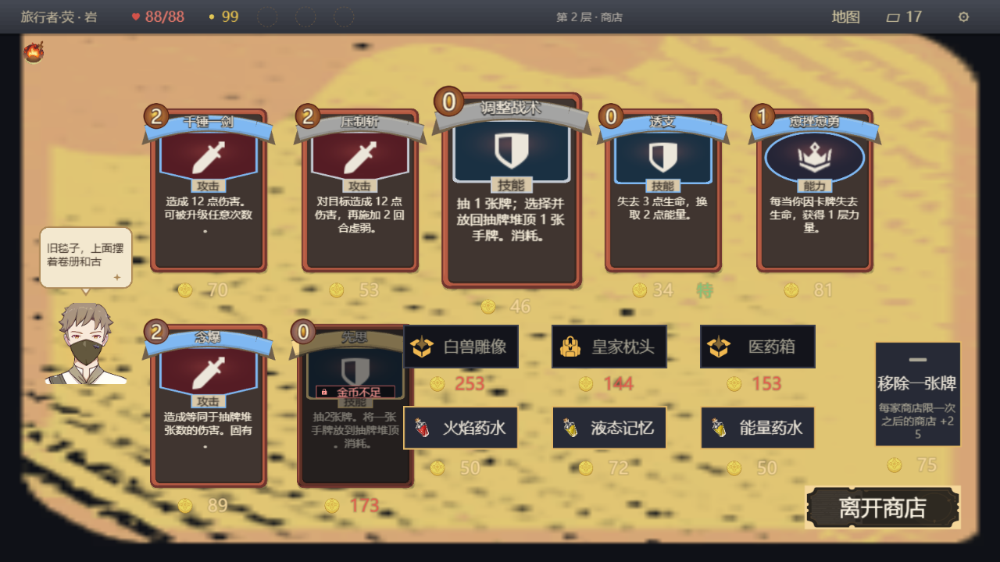
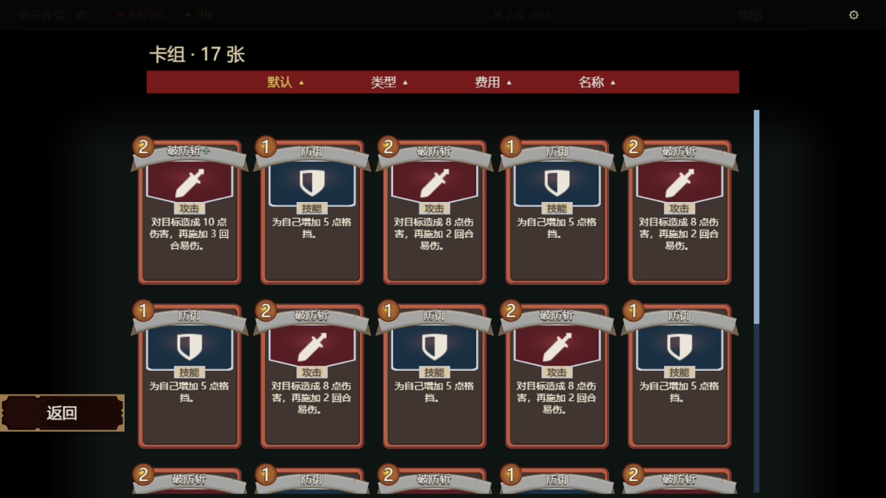

# 商店与 17 张永久卡组：最终稳定源码离线视觉证据

**已用最终稳定源码重新构建、运行并逐张打开查看 10 张 1280×720 原始 Simulator 画布 PNG。当前交付唯一目录为 `visual-current/`，当前本机会话为 `.artifacts/shop-deck-parity-20261112/current-final/`。** 商人浅色头顶气泡不遮商品／价格，底部中央头像黑条消失，离店按钮深底浅字，永久卡组采用暗场五列；顶部地图实际打开并一次返回商店。

此次刷新已包含独审后的浏览返回壳／generation门禁、merchant空分支清理、V25商人一致投影和路由模式表重构。没有沿用旧图充当新源码结果；旧图及失败轮完整保留在本机历史目录，见文末。

## 交付图片

| 图片 | 本轮看图结论 |
| --- | --- |
| [01-shop-bubble.png](visual-current/01-shop-bubble.png) | 左侧商人独立头像，米白气泡及下方尾巴位于头顶；气泡约 x50–170/y291–379，最近商品从 x184 起，无遮挡。原底部中央黑条未出现；右下“离开商店”为浅色字，顶部“地图”可见。 |
| [02-leave-hover.png](visual-current/02-leave-hover.png) | 悬停离店按钮，正文仍为浅字。 |
| [03-leave-pressed.png](visual-current/03-leave-pressed.png) | 按下变为更深底色，浅字仍清晰；随后在按钮外松手，未退出商店。 |
| [04-map-preview.png](visual-current/04-map-preview.png) | 真实 headless 指针从顶部“地图”进入预览，当前商店图标高亮，显示“请先完成当前节点”和左下返回。 |
| [05-shop-map-return.png](visual-current/05-shop-map-return.png) | 一次返回原第 2 层商店，原货架与价格恢复，人物和气泡仍在左侧。 |
| [06-deck17-top.png](visual-current/06-deck17-top.png) | 标题“卡组 · 17 张”，红色四项排序栏、黑色柔边暗场、五列卡牌，左下返回。 |
| [07-deck17-bottom.png](visual-current/07-deck17-bottom.png) | 原生网格真实滚到底，最后一行仅两张；17 个卡控件已实际实例化，非只改标题。 |
| [08-deck-card-detail.png](visual-current/08-deck-card-detail.png) | 点击当前可见首张，显示“破防斩+”永久牌组正文详情及来源说明；不是战斗临时牌堆。 |
| [09-deck-return-list.png](visual-current/09-deck-return-list.png) | 详情返回五列列表；PNG SHA256 与 06 完全相同，更新后的generation门禁未阻断合法返回。 |
| [10-shop-deck-return.png](visual-current/10-shop-deck-return.png) | 再次返回原商店，商人和货架恢复。 |




## 来源与证据级别

- 工作树 `F:\New folder\.worktrees\shop-deck-parity`，HEAD `903bf2a31e91f10fb24763ab4cea23d586d0bb83` 加本轮已有脏源码。未改生产源码、tests、theme 或 Backlog；仅新增本目录复现材料和工作树 `.artifacts/shop-deck-parity-20261112/` 产物。
- `buildLuaData` + `buildUI({officialAssets:true,nativePageLifecycle:true})` 从本轮源码重新生成布局和 Lua，使用既有生成器绑定六个模板。起跑时已确认 `merchant.official` 投影、official-run-layout 重建 merchant、official-battle-hud 添加 `runRoute`。
- 本轮运行 **365 个 Lua 模块 + 六个当前生成模板**。652 份源码／数据／配置输入完整 SHA256 清单见 [source-manifest.json](source-manifest.json)。验证时源码无漂移。新闭包 SHA256：`fe9c9210795a618770ff119fa20e447cf9b6b3b6de40ab94145f422d22232e80`。对应原始字节归档只保留在 `.artifacts/shop-deck-parity-20261112/current-final/source-closure.json.gz`；公开清单保留路径和压缩文件摘要。
- 优先复用了根 `.artifacts/simulator-runtime/`、`.artifacts/art-lab-runtime/` 与 `.artifacts/integrated-play-20261112/` 中已有工具。原 SDK SHA256 `8d10975a41285c54935d003bf68933586bd6bcf133328435ce8e944b005d94b8`，实际 renderer `5971287fabb54d2c061b76857bafffae6575b9e7612cb4bcc4ba95e88bb0aa20`，与 battle-piles-final-20261111 pipeline 一致；server/worker/bridge/hook/play 摘要均已校验。没有安装依赖或修改 renderer／SDK。
- 已有精确 adapter、SDK 和私有 renderer 均找到。转换器复用历史 gzip adapter 的控件转换逻辑及已校准的 `Basic`、默认描边、`Pixel` 枚举；输入改为当前 build 生成布局，分配本地控件 GUID，保留实际图片 ID。模板 GUID 复用归档值并以当前生成器重新绑定。未知布局属性为零。
- **这是当前生成布局 + 真 Lua 执行的 Simulator 启动夹具，不是 GIL 写入／读回、不是官方客户端、不是 GPU／手机证据。** 画面由既有 Pixi renderer 经 headless Chromium **SwiftShader 软件 WebGL** 实际绘制，不是效果图／组件重画。所有鼠标事件仅送往无窗口浏览器；未启动游戏／编辑器或触碰 OS 输入。
- 唯一 Lua 变体为归档 save 内 `abyss_game_ui.lua` 的 [shop-fixture.lua](shop-fixture.lua) 包装：seed42 开局、用真实命令完成开局恩赐，以受控 `Map.choose` 跳过途中房间，退休已完成的开局 flow，调用真实 `Nodes.enter` 生成第 2 层 `f2_l3` 商店库存，再注入 17 张交替防御／破防斩（首张已升级）的永久牌组。该夹具不证明自然游戏能取得此牌组／金币；不证明沿途战斗流程。本轮金币 99、生命 88/88 源于真实开局恩赐。其余源码保持清单中的字节。
- 实际 save SHA256 `9ce663ebd8e5ce95cceebbf2114a18e8d7317be926a31fb2fc2b308210e29fdd`，原始及压缩save只保留在本机 `current-final/current-shop.save.json` 和 `current-final/fixture-save.json.gz`。每张 PNG 均有已审查的同名 `.state.json.gz`，仅含SDK运行状态、合成玩家标签、场景树和网格状态；收据见 [render-receipt.json](visual-current/render-receipt.json)。

## 机械复核与看图边界

[verification.json](verification.json) 确认：10 张图片摘要与尺寸正确，652 份输入没有漂移，气泡与当时可见商品包围盒交集为零，离店文字运行时颜色 `#FFF8E7`，网格 `itemCount=17`／`columns=5`，滚动从 0→1，详情往返图像一致，地图与卡组均返回商店，Lua 错误为 0，显式停止回执 `running=false`。

逐张看图确认上述四项视觉目标。未验证离店禁用态、全部商品选择／支付、所有短句／超长文案、其他画布比例、控制器、读屏、官方设备触控、帧率或正式容量。商店背景与价格浅色在这条已有 Simulator 素材路线中的显示保留原样；该图不能用于承诺跨设备对比度达标。

最终浏览器控制台仍保留 **1 条 HTTP 400**；本次额外记录其路径为 `/editor/api/play`，未进一步归因到具体请求动作。无pageerror／Lua启动失败，十张目标画面及往返均实际完成；不写成“零错误”，不据此判定生产缺陷。有限视觉评审详见 [visual-review.md](visual-review.md)。

相对旧轮，04地图、06卡组顶部、07卡组底部、08详情、09详情返回列表这 **5 张 PNG 字节完全一致**；商人对白按时间推进，其他5张整图不相同，但逐张复核后四项目标保持一致。比较只用于说明像素，不代替新源码运行，结果见 [publication-audit.json](publication-audit.json)。

## PR 公开边界

[PUBLICATION.md](PUBLICATION.md) 提供本轮视觉证据的明确staging白名单；未执行git add或提交。原始source closure、fixture save、生成adapter、旧图／失败轮、SDK和图库全部留在 `.artifacts`，不stage。对原始归档及当前runtime快照的检查未发现嵌入SDK源码片段、base64参考图、账号值或凭据字面量；closure有3处参考路径文字，未带图片字节。检查范围和有限性见审计收据。原项目非商业许可及第三方许可保持原样。

## 已执行命令

以下是本次刷新实际执行的主要命令，均在本工作树执行。既有pipeline先前已经解压，本次直接复用。只运行必要渲染、视觉收据验证及公开材料审查；完整check由主agent负责。

```powershell
& 'F:\New folder\build\tools\node-v24.18.0-win-x64\node.exe' docs/evidence/shop-deck-parity-20261112/archive-previous.mjs
& 'F:\New folder\build\tools\node-v24.18.0-win-x64\node.exe' docs/evidence/shop-deck-parity-20261112/prepare-visual.mjs .artifacts/shop-deck-parity-20261112/current-final
& 'F:\New folder\build\tools\node-v24.18.0-win-x64\node.exe' '--import=file:///F:/New%20folder/.artifacts/simulator-runtime/preview-tools.mjs' docs/evidence/shop-deck-parity-20261112/capture-visual.mjs .artifacts/shop-deck-parity-20261112/current-final docs/evidence/shop-deck-parity-20261112/visual-current
& 'F:\New folder\build\tools\node-v24.18.0-win-x64\node.exe' docs/evidence/shop-deck-parity-20261112/verify-evidence.mjs
& 'F:\New folder\build\tools\node-v24.18.0-win-x64\node.exe' docs/evidence/shop-deck-parity-20261112/audit-publication.mjs
```

复现时prepare/capture要求新输出目录，避免覆盖原始证据；`verify-evidence.mjs`可传新的视觉目录。新机器可先运行 `unpack-pipeline.mjs` 复原仓库已有脚本，但仍需README列明的既有私有工具。其余本机工具位置与版本见脚本和verification；依赖及其原许可保留在既有安装，不打包私有SDK／图库。

## 完整保留的历史轮次（仅本机）

旧docs输出全部移入 `.artifacts/shop-deck-parity-20261112/history-before-final-refresh/`：`visual/`、`visual2/3/4/5/6/7/`、`visual-final/`、旧source manifest/closure、fixture save、verification、原README与复现脚本。共78个归档文件，逐文件摘要在 `archive-manifest.json`。旧`.artifacts/current…current6`也完整保留。没有覆盖其他owner的 `independent-review.md`；其中旧 `visual-final/` 路径是历史记录，已迁入上述本机归档。

历史故障说明：`current`为CRLF预检失败；`visual`为TEMP权限失败；`visual2…5`为夹具绑定／开局所有权预检失败；`visual6`快点击未开地图；`visual7`误选离屏卡项后超时；旧`visual-final`为修正取证脚本后成功的第一轮。它们不是当前生产启动失败证据。本次稳定源码新建`current-final`／`visual-current`，一次完整取得十图；未进行Simulator性能修改或研究。
