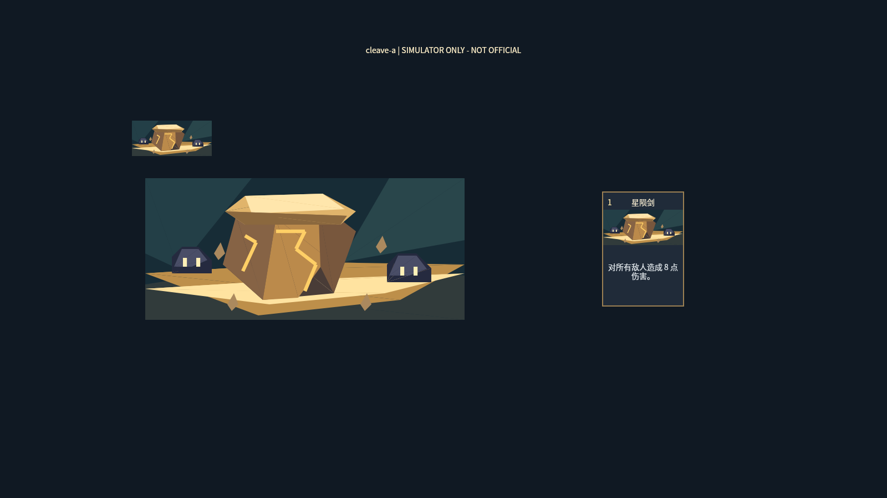

# TASK-107 / PR #657: reference-led native illustration probe

**Research only. Not approved art. No runtime registration, production replacement, official-client or device acceptance.**

## First result: NO-GO for production

Independent [visual and geometry review](REVIEW.md) rejected this probe. Geometry indices 4/5/12 are concave: current fan triangulation overdraws outside their intended boundary. The source SVG and native image are NOT geometry-equivalent. This broken exporter is preserved only to reproduce the failure; it must not be reused for production. Fix correct triangulation before any next visual iteration.

A single native `cleave` / **星陨剑** probe is rendered at 144×64, enlarged 4×, and in a 148×208 diagnostic card. It preserves the capped Geo construct, amber veins and two targets, but loses the reference's rounded masonry, material richness and impact depth. Low control count is not visual acceptance. Three other authored layouts fail the existing legal single-axis triangle solver and are recorded in `failures.json`; they are **not** rendered/validated candidates. Do not expand this style to 75 cards.



## Exact references and identity

Base: `9f2f44e4c79789fbcb64a515938765dbc240f830`.

| Candidate | Exact reference | Visual reason / card mechanic |
|---|---|---|
| cleave-a | [existing detailed source](../../art/cards/traveler-geo/cleave/source.png) | Single broad, flat-capped Geo construct, amber veins, ground impact affecting multiple targets; base damageAll 8, upgrade 11 |
| armaments-a (solver blocked) | [existing detailed source](../../art/cards/traveler-geo/armaments/source.png) | Silver/white bracer, blue binding and clasp being repaired by a tool; block + temporary hand upgrade |

Reference SHA256: cleave `6e37a7b9264154a2cd7e6560a625cf001b3b00d63e8fdbf4d01369a714397155`; armaments `e63cd8703ce983eb1556efa31a017b803e31c7b887e9c3e14c77bd3ba9928332`. Existing project references only; no raster texture imported into runtime. Display names are read from `data/presentation/traveler.zh-CN.json`; numeric values from `data/cards.json`. The diagnostic card is **not** the approved card-frame reproduction; it exists solely for size/context and uses simulator fonts.

## Reproducible changes

1. Extracted specific reference motifs rather than a broad style prompt. Directly authored planar geometry, not generated-image tracing. This proved insufficient reproduction fidelity; source matching must precede further stylization.
2. Initial cleave right-face triangulation failed. Moved its `[82,36]` vertex to `[79,40]` in that face only. This is a documented shape alteration, not solver-equivalent optimization.
3. Initial valid sample: 74 images + 1 group = 75 controls. Fine veins represented as two triangles each.
4. Final sample: veins represented by **one rotated native rectangle** each, same line endpoints/width. 68 images + 1 group = **69 controls**. No masks or raster textures. Actual native tree checked, not SVG polygon count. The sheet repeats the tree three times; 69 is per-art, not entire-sheet count.
5. Alternate overhead cleave and two armaments layouts were attempted, not substituted silently. Failure reason is preserved. No automatic trace-fit or illegal transform fallback.

## Reproduction

From repository root (Python with NumPy):

```
python experiments/card-art-lowcost/build.py
ART_LAB_MCP_ENTRY=/path/to/beyond-simulator-mcp/dist/index.js node experiments/card-art-lowcost/run.mjs
```

Tool used: `beyond-simulator-mcp@0.5.2`. Existing `experiments/art-tech-lab/rpc.mjs`, seed and `scripts/art/native-triangle-placement.py` are reused. Native shapes: `100001` rectangle and `100003` triangle. `*.native.json` is one art subtree; `*.save.json` is the comparison board. Source SVG/geometry are authoring evidence, **not** screenshots. `*.host.png` and receipt are actual simulator output. Unsupported geometry remains a reported failed candidate.

No full-suite test, official editor, user GUI, performance or load claim. Performance 0/1/5/10 load matrix is deliberately deferred until a visual candidate qualifies. Next iteration must first improve reference silhouette/material/impact at 144×64 under independent review, rather than add detail indiscriminately or chase a lower count. Formal enablement remains forbidden pending owner approval and required device acceptance.
