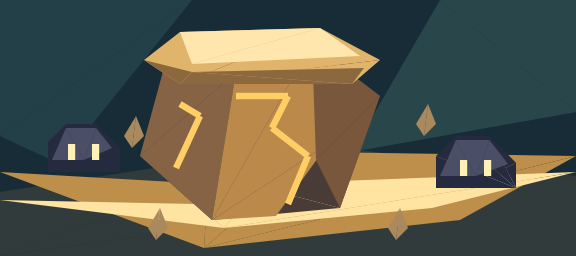
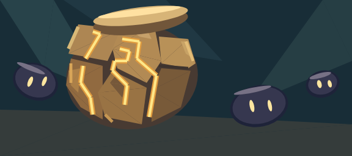
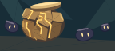
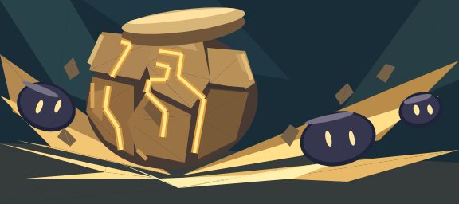

> **Lightweight preview delivery:** This branch preserves reviewed 1×/4× simulator crops, review, counts and reproducible source code. Large generated native/save JSON and full sheets are not included in this preview commit. Run build.py and run.mjs to regenerate them; validation results below describe the frozen full local run, not CI on this partial archive. No production integration.

# Round 2 — reference reconstruction, not production art

Original reference: [星陨剑 detailed source](../../../art/cards/traveler-geo/cleave/source.png), SHA256 `6e37a7b9264154a2cd7e6560a625cf001b3b00d63e8fdbf4d01369a714397155` (unchanged from round 1).

The target is the same specific capped Geo construct and impact. This does not adopt a generic low-poly style as approval. Controls still must meet the existing budget; aesthetics, actual mechanic readability and native fidelity remain separate gates.

## Changes isolated by stage

1. **cleave-a-corrected**: original authored shapes/colors retained; replace invalid fan triangulation with deterministic ear clipping. No enlargement or triangle fit. This isolates conversion correctness from artistic revisions.
2. **cleave-reference-shape**: explicitly reconstruct the source's rounded, segmented body; separate thick cap, recessed joints and brighter bevels; trace its angular gold-channel rhythm. Targets now have asymmetric round bodies and tilted oval eyes instead of gabled polygons. Background remains quiet so the restored silhouette/material can be judged separately. Native ellipse `100002` is used directly, not represented by dozens of triangles.
3. **cleave-reference-impact**: same body/targets as stage 2; only replace quiet ground with radiating wedges from the impact point and add five pieces of flying debris. The objective is to stop the AoE being read as a static floor. This is a separate comparison, not an automatic replacement.

All sheets include true 144×64 art, 4× art, and a diagnostic 148×208 card. The diagnostic frame is not the approved card-frame reproduction. PNGs are simulator screenshots, not official-editor/device verification. SVG files are authoring sources, not runtime evidence. No formal assets or runtime registries are modified.

## Review status

**Independent visual review completed:** [full review](REVIEW.md). The 92→122 control comparison may be shown as an improved research direction, not a premium/production pass. The corrected 71-control old composition remains rejected. Remaining issues: floating cap, jar-like body, gold channels without material illumination, impact still somewhat ribbon-like. Do not expand to other cards or start load tests yet. Consult `counts.json` and `failures.json` for actual exports; official acceptance remains false.

## Actual rendered comparison

The following are **unmodified crops of the native simulator screenshot**: 4× art region `(262,322,838,578)`, 1× region `(238,218,382,282)` on the 1600×900 sheet. Cropping is for inspection only; runtime is still native controls, not these PNGs.

### 1. Same original art, geometry corrected — 71 controls

### 2. Specific reference silhouette and segmentation — 92 controls

### 3. Same shapes, added directional impact — 122 controls

## Verification

`python experiments/card-art-lowcost/test_triangulate.py`: 8 tests passed in 0.756 seconds. Now includes **all generated round2 polygons**, in addition to frozen old-failure fixtures, both windings, area/containment and actual native transform vertex reconstruction within `1e-7`. Ellipse source records are excluded from polygon tests; their rendering is inspected visually, not claimed to be polygon-tested.

`python experiments/card-art-lowcost/check_outputs.py`: all three counts checked against native trees, unique IDs/guids, only native shape IDs, no scripts, each below experimental ceiling 150. `failures.json` is empty. This is not a benchmark or official-client test.

The strict validator initially rejected two newly authored impact polygons for crossing edges. They were replaced by explicit simple three-point rays before export, rather than hiding intersections with overlap. Their point changes are in `reference_study.py`; no reference pixels were changed.
